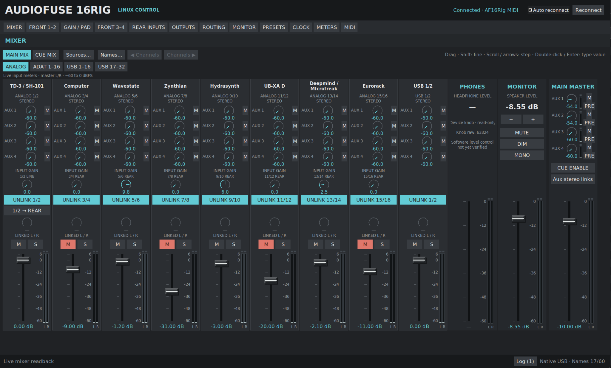
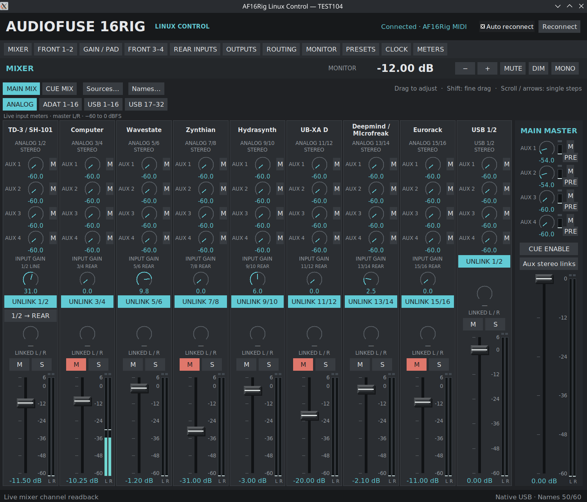

# AudioFuse 16Rig Linux Control Centre · BETA RC

An independent Linux desktop control panel for the Arturia AudioFuse 16Rig. Mix analog, ADAT and USB channels, patch sources to destinations, and manage presets stored on the interface. The app reads the rig’s channel names when it connects.



*Main Mix on a connected 16Rig. Both screenshots are from earlier Linux development builds. The BETA RC places channel PAD beside Mute and Solo.*

## Install on Linux

Download the repository with **Code → Download ZIP** and extract it, or clone it with Git. Open a terminal in the folder containing `run.sh`. The application uses Python 3, Tk, system libusb and ALSA. On CachyOS or Arch Linux you can install the dependencies with:

```sh
sudo pacman -S --needed python tk libusb alsa-lib
```

With the 16Rig connected by USB, run:

```sh
bash setup-usb-access.sh
bash install-desktop.sh
```

Open **AF16Rig Linux Control** from the applications menu. The first script installs a udev rule for the 16Rig MIDI/control USB device. The second installs the application for your user, including its boxed 16 RIG icon. You can then move or delete the downloaded folder. To update, close the app and run the installer from the new copy.

You can also run it directly with `bash run.sh`, or explore the interface offline with `bash run.sh --demo`.

## Using the mixer

- **Main Mix and Cue Mix** have separate faders, sends, pan, mute and solo. The Analog page includes the USB 1/2 return so you can adjust computer playback alongside the hardware inputs.
- **Front and rear inputs** expose the controls available for the selected source. Linked pairs share a gain knob. The Phones, Monitor and Main Master strips sit together at the right.
- **Routing** presents a patchbay. Select one of eight cable colours, then drag a cable between compatible jacks.
- **Presets** reads, names, saves and loads presets on the device. Mixer scenes are files on your computer. Open a scene to preview differences before recalling them. Sample-rate changes require internal clock and idle ALSA streams.



## Validation and scope

BETA RC is based on TEST167. Its automated suite passed 1,388 tests, and the desktop demo passed all 61 GUI checks on CachyOS with Python 3.14 and Tk 8.6. The remaining hardware check is a scene recall covering input sources, stereo links and sample-rate readback. Installed launcher and taskbar icon appearance still need a desktop confirmation.

MIDI Learn and immersive/bass management are outside this release. Phantom-power control remains unmapped.

To repeat the automated checks:

```sh
python3 -m unittest discover
bash test-gui.sh
```

Run the second command from a graphical desktop. It exercises the real Tk interface in demo mode, blocks physical USB access and writes `AF16Rig-GUI-check.json` in the application folder.
